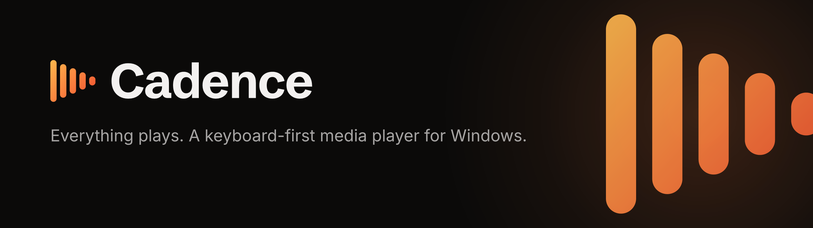
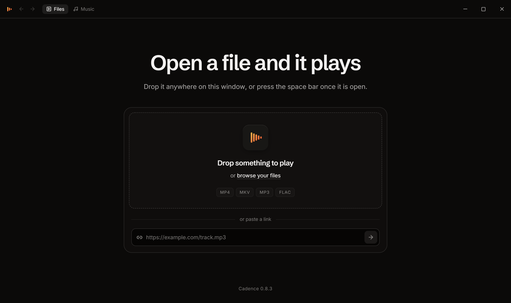

<p align="center">
  <a href="https://cadence.auva.dev">
    
  </a>
</p>

<p align="center">
  <a href="https://github.com/mohanvd/cadence/releases/latest"></a>
  
  <a href="https://github.com/mohanvd/cadence/actions/workflows/ci.yml"></a>
  <a href="LICENSE"></a>
</p>

<p align="center">
  <a href="https://cadence.auva.dev/download"><b>Download for Windows</b></a>
  &nbsp;·&nbsp;
  <a href="https://cadence.auva.dev">Website</a>
  &nbsp;·&nbsp;
  <a href="CHANGELOG.md">Changelog</a>
  &nbsp;·&nbsp;
  <a href="https://github.com/mohanvd/cadence/issues/new/choose">Report a problem</a>
</p>

<br>

**Cadence** is a keyboard-first media player for Windows. It carries its own
decoder, so the MKV that stalls everywhere else plays here, and it keeps your
music library in the same quiet window.

No account, no administrator rights, no telemetry. Files are read from disk
and never leave it.

<p align="center">
  
</p>

## Install

Download it from [cadence.auva.dev](https://cadence.auva.dev) and run it.
No administrator rights are required.

Cadence updates itself: new releases are downloaded in the background and
applied the next time you restart it. To make it the player for a kind of file,
right-click one, choose **Open with** > **Choose another app**, pick
**Cadence** and tick **Always**. Windows reserves that choice for you, so an
installer is not allowed to make it.

## What it does

**Plays what you throw at it**

- MP4, MKV, AVI, MOV, WMV, FLV, TS, M2TS, MPEG and more, with the codecs
  inside them: H.264, HEVC, AV1, AC-3, DTS
- The container is unwrapped and the picture handed to your graphics card
  untouched. Nothing is re-encoded unless a codec has to be, and then the
  encoder is the card's own
- Subtitles from inside the file: every track it carries, by name and
  language, whether plain text, styled ASS drawn by libass, or Blu-ray
  pictures. Or from a local `.srt`, `.vtt`, `.ass` or `.ssa`, with adjustable
  timing
- Plays the rest of the folder: the next file starts when one ends, in the
  order the names read, for a season of television and an album alike
- Resumes each file where you stopped. Speed from 0.25× to 4×, frame-accurate
  stepping, timestamp bookmarks with notes, and the current frame saved as a
  PNG

**Keeps your music**

- MP3, M4A, FLAC, WAV, Opus, Ogg, AAC, WMA and more. Lossless stays lossless:
  FLAC and Opus reach the decoder untouched, and the formats that cannot are
  converted to FLAC rather than to AAC
- A library. Point it at a folder and it reads the tags once. Albums are
  sleeves, artists are a list, and a search lets each word match a different
  field. Every folder inside becomes a playlist, because you already did the
  sorting
- Playlists, shuffle, repeat, and a queue that follows whatever you started.
  Import an `.m3u` from a phone or another player and it finds the music by
  name and tag even when its paths point at a device you no longer have
- Playback carries on while you look for the next record, with a bar along the
  bottom to get back to it
- Fix what a file says it is, for one track or a whole record. It is written
  into the file, so every other player sees the correction, and nothing is
  re-encoded

**Stays out of the way**

- Every control is one key away, and every key can be changed. Right-click
  almost anything for what you can do with it
- Settings for all of it in one place, Ctrl+comma from anywhere, with a search
  to find any one of them
- The Windows media keys and Now Playing panel, and Discord, if you switch it
  on
- Drag a file anywhere onto the window, open one from the dialog, or
  double-click it in Explorer

## Keyboard shortcuts

| Key | Action |
|-----|--------|
| Space / K | Play / pause |
| ← / → | ±10 seconds |
| J / L | ±30 seconds |
| , / . | Previous / next frame |
| Home / End | Jump to start / end |
| N / P | Next / previous file |
| F | Fullscreen |
| C | Subtitles |
| S | Save frame as PNG |
| ? | Show all shortcuts |

## Layout

```
app/         the player: a React interface, built with Vite
site/        cadence.auva.dev: an Astro page that ships no JavaScript
src-tauri/   the shell: a native window, written in Rust
brand/       the mark, the design tokens and the brand guide
```

The two front ends are separate projects with separate toolchains, and neither
one reads a file out of the other's directory. The site used to import the
player's stylesheet so that its picture of the window could not drift from the
window; it carries its own copy now. That import cost a Vercel project setting
to permit reading above the deployed root, and a build failure that said nothing
about why, which is a steep price for a landing page. The note at the top of
`site/src/styles/base.css` says what the copy owes the player and which files to
read it against when the two disagree.

## Building from source

Cadence is a [Tauri](https://tauri.app) application: a React interface in a
native window, with the shell written in Rust.

You will need [Node.js](https://nodejs.org) 22 or newer, the
[Rust toolchain](https://rustup.rs), and the Visual Studio C++ build tools.
The build tools need the Windows SDK component, which the C++ workload
installs; without it the Rust linker has no `kernel32.lib` to link against.

```bash
npm install
npm run fetch:ffmpeg  # once, before the first desktop build
npm run app:dev       # run the player
npm run app:build     # produce an installer
npm run site:dev      # run the website
```

`npm run dev` serves the interface on its own in a browser, which is a faster
loop for work that does not touch the desktop shell. Playback there is limited
to what the browser opens by itself, because the pipeline below lives in the
shell.

Six things are worth knowing, because none of them has anywhere to say so:

- Cadence plays what it plays because FFmpeg is bundled with it. The binaries
  are not in the repository: they are 138MB of somebody else's build output and
  go stale the moment upstream fixes a decoder, so `npm run fetch:ffmpeg`
  downloads a pinned LGPL build into `src-tauri/ffmpeg/`. The bundler treats
  that directory as a resource, and a build without it produces an installer
  that runs and cannot open a Matroska file.

- Subtitle scripts, ASS and SSA, are drawn by libass, compiled to
  WebAssembly and shipped as `jassub`. It is the library mpv and VLC draw them
  with, and it is here for the same reason FFmpeg is: the format has no
  specification worth the name, so a second implementation would only be a
  second set of answers. Like FFmpeg it is LGPL, and like FFmpeg it is pinned
  to an exact version, because the player names files inside the package,
  which is not something a minor release promises to keep still.

- `version` in `src-tauri/tauri.conf.json` is a path to `package.json` rather
  than a number. That file is the only place a version is written, so the
  installer, the update manifest and what the app reports cannot drift apart.
- `src-tauri/installer/installer.nsi` is Tauri's own NSIS template, pinned to
  the CLI version, with three changes: the wizard is skipped, the player is
  started afterwards, and file types are registered under Cadence's own class
  names with an "Open with" entry rather than through Tauri's `APP_ASSOCIATE`.
  Each is commented in place. It has to be re-pinned when the CLI is upgraded.
- The updater runs that same installer with `/P /R /UPDATE`. Anything done to
  the template has to leave those working. The `Installer` workflow proves the
  registry half of that on every change to the template: it builds the
  installer, upgrades the last release to it, uninstalls, and checks what each
  step left behind (`scripts/test-installer.ps1`). Whether the updater itself
  then finds and applies the release can still only be proved by two real
  releases.
- The icons, favicons, installer bitmaps, link previews and the design tokens
  in `app/` and `site/` are all generated from `brand/` by `npm run brand`.
  Edit the master there, run the script, and commit what it wrote. See
  [brand/README.md](brand/README.md).

## Releasing

Releases are cut from tags. Pushing a `v*` tag builds the installer, signs it,
and opens a draft release with the update manifest attached; publishing that
draft is what delivers the update to everyone already running Cadence.

`package.json` is the only place a version number is written: the installer and
the version the interface reports are both read from it.

```bash
npm version minor          # commits the bump and tags it
git push --follow-tags
```

### Where the files go

The release is created in this repository, on the tag that was pushed, and the
installers are attached to it.

Nothing outside points at GitHub directly, though. Both public addresses go
through the site:

| Address | Redirects to | Who asks for it |
|---|---|---|
| `cadence.auva.dev/download` | `Cadence-Setup.exe` on the latest release | the download button |
| `cadence.auva.dev/latest.json` | the update manifest on the latest release | every installed copy |

Both are ordinary redirects in `site/vercel.json`. This indirection is not
decoration. `latest.json`'s address is compiled into every binary ever shipped
and can never be changed retroactively, so it has to name something we will own
for as long as Cadence exists. The files have moved twice already, out of this
repository and back into it, and the second move was one line of `vercel.json`
because of this; it must never again be a new build.

The workflow uploads the installer twice: once under the bundler's own name,
`Cadence_<version>_x64-setup.exe`, which is what the update manifest points at,
and once as `Cadence-Setup.exe`, which is what the redirect above resolves to.
The second exists because a link cannot name a filename that changes every
release.

### Secrets

One, on this repository, and a second if the key has a password:

| Secret | Without it |
|---|---|
| `TAURI_SIGNING_PRIVATE_KEY` | the installer is unsigned and the updater rejects it |
| `TAURI_SIGNING_PRIVATE_KEY_PASSWORD` | a key that has a password cannot be opened |

Creating the release needs no secret: the workflow's own token does it.

## Brand

The mark, the palette, the type and the voice are written down in
[brand/README.md](brand/README.md), with every logo file and the design
tokens beside it.

## Licence

Cadence is proprietary. The source is here to be read, and the licence is not
an open-source one: see [LICENSE](LICENSE) for what it does and does not grant.

It is built on components that are not, and two of them, FFmpeg and JASSUB,
are LGPL and place real conditions on how it is shipped. Those conditions are
written out in [THIRD-PARTY-LICENSES.md](THIRD-PARTY-LICENSES.md), including
one that has to be settled before the Android player is written.
