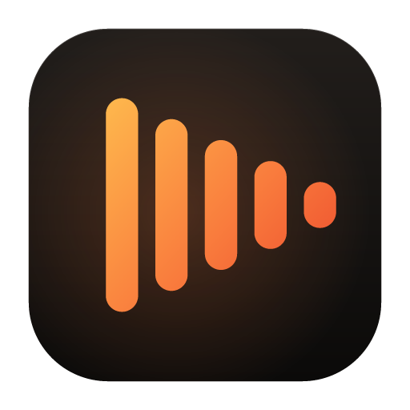
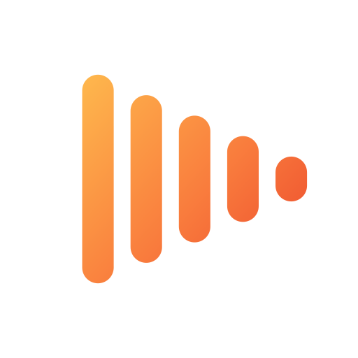
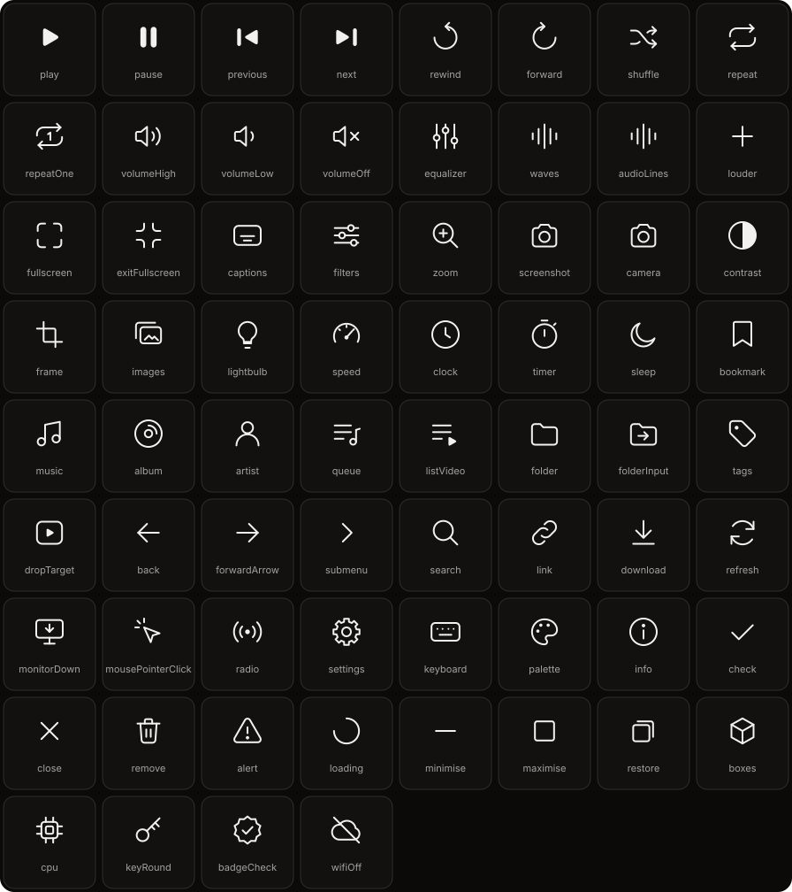

  

# The Cadence brand

What Cadence looks like, why, and where each piece of it lives. This directory
is the master copy of all of it; everything else in the repository that carries
the brand has a copy made from here by `npm run brand`.

## The idea

**Everything plays.** Cadence opens the file that other players hand back,
keeps a music library in the same window, and gets out of the way of both.
The brand has the same job: be recognisable at sixteen pixels, and then be
quiet.

In music, a *cadence* is how a phrase resolves: the beats that fall away into
the end of a line. The mark is exactly that, five beats falling away, and their
outline is the play button. One reading for people who think in music, one for
people who think in buttons, and both are true.

## The mark

  
  &nbsp;&nbsp;
  

Five rounded bars, tall to short. Each bar is as tall as a play triangle is at
that point, so the right-hand ends trace the triangle's two edges, and the last
bar is a dot. It is centred optically, not geometrically: a play glyph carries
its weight on the left, and a box-centred one looks as if it is sliding off to
the right.

There are two cuts:

| Cut | Bars | Use it |
|---|---|---|
| Full | 5 | at 32px and above |
| Small | 3 | at 24px and below: favicons, the title bar, the smallest icon sizes |

The mark is geometry, not a drawing. It is generated by
[`source/artwork.py`](source/artwork.py) from four numbers per cut (bar count,
height, pitch and weight), and the same numbers are used by the `Mark`
component in the player and on the site. To change the mark, change those
numbers in all three places and rerun the generator.

**Clear space.** Keep a margin of at least one bar's width plus one gap (about
a fifth of the mark's height) on every side.

**Don't** rotate it, outline it, put it in a circle, change the bar count
outside the two cuts, or fill it with anything but the signal gradient, solid
ember, or one solid colour taken from the text it sits beside.

## The name

*Cadence* is set in **Schibsted Grotesk Bold**, tracked in by 2.5%. In the
lockup the tallest bar is 1.3 cap heights, centred on the capitals, with 0.42
cap heights between mark and name. In running text the name is always written
*Cadence*: capital C, never in capitals, never "cadence".

The words are converted to outlines in every logo file, so they render the same
on a machine without the font, including on GitHub.

## Icons

Cadence draws every icon it shows, in the player and on the site, from one set
of its own: [`icons/glyphs.mjs`](icons/glyphs.mjs). It replaced Lucide, whose
proportions and play button were the two things in the window that plainly
came from another drawing.

- **One stroke**, set in screen pixels by the component that draws it, so a
  14px icon and a 24px icon carry the same line: 1.75px in the interface,
  1.25px for the window's own controls. Round caps and joins, the roundness of
  the mark's bars.
- **Keylines.** The live area is 3 to 21 on a 24 grid. A circle is 18 across,
  a square 16, an upright rectangle 14 by 18 and a wide one 18 by 14, which is
  where shapes of different kinds look the same size.
- **Transport is solid**, built from the mark's pieces: rounded bars, and a
  play triangle with its corners turned. Everything else is outline.
- **Optical centring.** Play sits a unit right of its box's centre, as the
  mark does, because its weight is on the left.
- **Sound is the mark.** Anything that stands for audio is the mark's own run
  of bars.

`npm run brand` writes the set into `app/` and `site/` as `glyphs.ts`, and
draws the sheet above. To add one, draw it in `glyphs.mjs` to the rules above,
run the script, and use it by name.

## Files

| File | What it is |
|---|---|
| `logo/cadence-icon.svg` | The application icon: the mark on a lit tile. 1024 square. |
| `logo/cadence-icon-small.svg` | The same at 32px and under: small cut, no margin. |
| `logo/cadence-mark.svg` | The mark alone, in the signal gradient. |
| `logo/cadence-mark-small.svg` | The small cut, in the signal gradient. |
| `logo/cadence-mark-mono.svg`, `-small-mono.svg` | One colour: `currentColor`, so it takes the colour of whatever it sits in. |
| `logo/cadence-wordmark.svg` | The name alone, `currentColor`. |
| `logo/cadence-lockup-dark.svg` | Mark and name, for dark grounds. |
| `logo/cadence-lockup-light.svg` | Mark and name, for light grounds. |
| `social/og-image.*` | The link preview the site serves, 1200 × 630. |
| `social/github-social.*` | The repository's social preview, 1280 × 640. |
| `social/readme-banner.*` | The banner at the top of the README. |
| `tokens/tokens.css` | Every colour, size, duration and typeface. The source of truth. |
| `tokens/tokens.json` | The same, as design tokens, for importing into a design tool. |
| `icons/glyphs.mjs` | Every icon, as SVG on a 24 grid. The source of truth. |
| `icons/preview.svg` | All of them on one sheet, named. |

## Colour

There is one theme, and it is dark. Cadence is used in a dark room in front of
a bright picture, and chrome lighter than the film is chrome you are looking at
instead of it.

### Ink, the neutral

Near-black with a trace of warmth (OKLCH hue 60, chroma 0.004), so the grey
beside the accent reads as its shadow rather than as steel. Authored in OKLCH,
where equal steps in lightness look like equal steps.

| Token | Hex | Role |
|---|---|---|
| `--cd-ink-950` | `#0B0A09` | the ground |
| `--cd-ink-900` | `#12110F` | raised once: panels |
| `--cd-ink-850` | `#1B1918` | raised twice: cards, inputs |
| `--cd-ink-800` | `#262423` | menus, the top of the stack |
| `--cd-ink-750` | `#2F2D2C` | hairlines |
| `--cd-ink-700` | `#413F3E` | hairlines that must be seen |
| `--cd-ink-600` | `#5D5A59` | disabled |
| `--cd-ink-500` | `#8E8C8A` | subtle text: 5.9:1 on the ground, and still 4.6:1 on a menu |
| `--cd-ink-400` | `#A6A4A3` | muted text, 8.0:1 |
| `--cd-ink-100` | `#F3F1F0` | text, 19:1 |

### Ember, the accent

| Token | Hex | Role |
|---|---|---|
| `--cd-ember-400` | `#FE9B61` | accent as text on the ground; hover |
| `--cd-ember-500` | `#F97C3D` | **the accent**, 7.5:1 on the ground |
| `--cd-ember-600` | `#E25C26` | pressed |
| `--cd-amber` → `--cd-flame` | `#FEB84D` → `#EB472C` | the signal gradient, worn only by the mark |

Warm on purpose. A player is used with the lights off, and warm light is the
light the eye forgives at night; blue is the colour a screen is told to stop
emitting after dark. It is also not the colour of any other player on the
shelf.

**One hue.** Ember marks what is live or chosen: the playhead, a toggle that is
on, a focus ring, and the single primary action on a screen. Everything else is
ink. If a screen has two ember buttons, one of them is wrong.

Text on ember is ink-950 (7.4:1), never white (3.6:1 on ember-600).

The player lets a viewer choose another accent in Settings. Ember is the
default and the only one the brand uses anywhere else.

### State

`--cd-success`, `--cd-warning`, `--cd-danger` and `--cd-info`, each at the
accent's lightness so none of them shouts over another.

## Type

| Family | Job |
|---|---|
| **Schibsted Grotesk** | The name, and headings. Nothing smaller than 18px. Bold for the name, semibold for headings. |
| **Inter** | Everything a person reads or operates. |
| System monospace | Keys and timecodes. |

Both are under the SIL Open Font Licence and both are shipped with the player
and the site rather than fetched, because a player that opens files from a
local disk has no business needing a network connection to draw its own text.

The scale runs 11, 12, 13, **14** (body), 16, 18, 21, 26, 33, 42, 56, and a
display size that grows with the viewport. Display type is tracked in as it
grows (−3.5% at display, −2% at heading); text is left as drawn.

Figures are tabular in the interface, so a running timecode does not wobble,
and proportional in headings, where Schibsted Grotesk's tabular comma and
colon would read as a space typed in front of them.

## Space, shape, light, motion

- **Space** is a 4px grid: 4, 8, 12, 16, 24, 32, 48, 64, 96, 128.
- **Corners** grow with the thing they belong to: 4px for a key, 8px for a
  control, 16px for a panel, 22px for a card or a window. Pills are for things
  that toggle.
- **Light** comes from above. Everything raised gets a hairline of light along
  its top edge (`--cd-sheen`) and a long, soft shadow beneath (`--cd-lift-*`).
  On a near-black ground a tight shadow is invisible; what lifts a card is the
  absence of light under it. The only glow (`--cd-glow`) is behind the mark or
  the one primary action, and two glows on a screen is none.
- **Motion** uses one curve (`--cd-ease`) that spends its travel early and
  settles. Durations are 120, 200 and 360ms in the player; the site may use
  620ms for things scrolling into view. A player that animates is a player
  that is late, and every animation goes when the system asks for reduced
  motion.

## Voice

The way the site, the changelog and the README already talk, written down.

- **Say what it does, plainly.** "Opens the MKV that stalls everywhere else",
  not "seamless playback for every format".
- **Explain the why.** A sentence of reasoning earns more trust than a
  superlative.
- **Short words, British spelling.** *Colour*, *licence*, *minimise*.
- **No exclamation marks, no em dashes, no "simply" or "just".**
- **Name the trade-off.** If something is not done yet, say so on the page.

The line is **Everything plays.** The description, wherever one sentence has to
do the work, is: *A keyboard-first media player for Windows. Films and music in
one quiet window.*

## Changing any of this

1. Edit `tokens/tokens.css` for colour, type, space or motion, or
   `source/artwork.py` for the artwork (and the `Mark` component's numbers in
   `app/` and `site/` if the mark itself changed).
2. If the artwork changed: `pip install fonttools brotli uharfbuzz`, then
   `python brand/source/artwork.py`.
3. `npm run brand`, which renders and copies everything into the player, the
   site, the shell and the installer.
4. Commit the master and every copy together.
